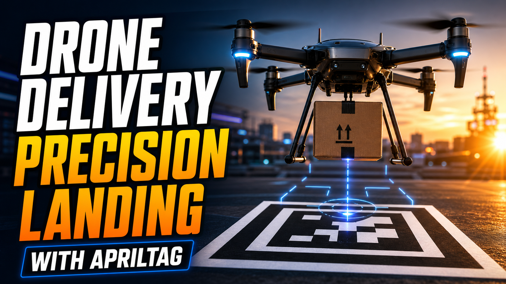

# Autonomous Drone Delivery & Precision Landing with AprilTag

[](https://youtu.be/m69HBxlxGLw)

*Click the image above to watch the drone fly the mission, find the pad, align, land and release its cargo.*

---

A custom quadcopter that flies a waypoint mission on its own, finds a printed
landing pad with a downward camera, corrects its own position and heading until
it is centred over the pad, lands on it, and releases its cargo — then reports
everything back to a ground station I wrote myself, over a 4G link.

Built and flown outdoors by one person over several months, from an empty frame
to repeatable autonomous landings.

---

## What this repository is

This is a **write-up, not a code drop.**

The repository contains this document and the images in it. The flight software,
the ground-station application, the flight logs, the vehicle parameter files and
the landing-pad geometry are **not published** — the project is part of ongoing
research work and is not open source.

What you will find below is *how the system is built and why each decision was
made*: the architecture, the failure modes I ran into, and the reasoning that
survived contact with a real aircraft. Enough, I hope, to be useful to someone
solving the same problem, without handing over the aircraft.

Some measured values — detection ranges, position errors, controller gains and
the results of the network experiments — are deliberately left out. They belong
to a paper that has not been published yet.

---

## The problem

GPS is not accurate enough to land on a target.

A consumer-grade GNSS fix is good enough to fly a drone to *roughly* the right
place. It is not good enough to put it down on a specific spot — a delivery box,
a charging pad, the back of a vehicle. The error is metres, and it drifts: it
changes with the satellite geometry, with nearby buildings, and, as I found the
hard way, with electrical noise from the drone's own USB 3.0 cabling and Wi-Fi
radio.

So the aircraft has to *see* where it is supposed to land, and close the last
few metres visually.

That is the whole project: **hand the final approach over from GPS to vision.**

---

## System overview

### Airframe and avionics

| Subsystem | Choice |
|---|---|
| Frame | ZD550 |
| Flight controller | H743-class FC running ArduCopter |
| ESC | 4-in-1, AM32 firmware |
| Companion computer | Raspberry Pi 5 (Debian) |
| AI accelerator | Hailo-8L 13 TOPS AI HAT |
| Camera | USB webcam, downward-facing |
| Navigation | Dual GNSS (primary + secondary with integrated compass) |
| Additional sensing | Optical flow / rangefinder module over MSP |
| Telemetry & remote access | USB 4G modem on an overlay VPN |
| Payload | Servo-actuated gripper, commanded over MAVLink |
| Battery | 6S LiPo |

A note on the AI accelerator, because it looks misleading in the table: **the
landing pipeline does not use it.** Tag detection and pose estimation are
classical computer vision and run comfortably on the Pi's CPU. The accelerator
is on board for the next phase of the project — monocular depth and obstacle
avoidance — and I would rather say so than let a spec sheet imply a neural
network is flying the aircraft.

### Separation of concerns

The single most important architectural rule in this project:

> **The companion computer never touches the flight controller's serial port
> directly.** Everything goes through a MAVLink router.

```
   Flight Controller (ArduCopter)
             |  serial
             v
      +--------------+
      |   mavlink-   |
      |   router     |
      +--+----+----+-+
         |    |    |
         |    |    +------>  passive research logger   (read-only)
         |    +----------->  ground-station app        (operator commands)
         +---------------->  vision & control script   (the autonomy)
```

Three independent UDP endpoints, three independent programs. This costs a few
milliseconds of latency and buys three things that turned out to matter far more:

- **A crashed autonomy script cannot take down telemetry.** This was not
  theoretical. The vision script died mid-landing on one flight; the aircraft
  held its position, the ground station kept working, and I brought it down
  manually. Had they shared a process, I would have lost the link at the worst
  possible moment.
- **The research logger is genuinely passive.** It has no command path at all —
  it cannot influence the flight it is measuring, by construction rather than by
  discipline.
- **Any component can be restarted in the field** without rebooting the others.

The router itself is [mavlink-router](https://github.com/mavlink-router/mavlink-router),
deployed using **[mavlink-anywhere](https://github.com/alireza787b/mavlink-anywhere)**
by Alireza Ghaderi — see [Acknowledgements](#acknowledgements). Getting a router
built, configured and surviving reboot on a companion computer is the kind of
task that quietly eats a weekend, and that project turned it into a solved
problem for me. Routing is also the layer where the architecture above is
actually enforced: adding an endpoint is a line of configuration, which is why
splitting one link into three separate consumers cost nothing and could be
reversed if it had turned out to be a bad idea.

---

## The landing pad

A single AprilTag has a narrow useful range. Far away it is too few pixels to
decode; up close it leaves the camera frame entirely — and it leaves the frame
exactly during the final metre, when you need it most.

The pad solves this with **four nested tags of different sizes** printed on one
A0 sheet: a large tag readable from high altitude, down to a very small tag that
is still fully visible when the aircraft is nearly on the ground.

```
   +--------------------------------+
   |  +----------------------+      |    big tag  -> acquisition, high altitude
   |  |    +------------+    |      |    medium   -> mid approach
   |  |    |    +--+    |    |      |    small    -> final alignment
   |  |    |    |##|    |    |      |    tiny     -> touchdown, still in frame
   |  |    |    +--+    |    |      |
   |  |    +------------+    |      |
   |  +----------------------+      |
   +--------------------------------+
```

Each tag sits at a **measured offset** from the true landing point, so whichever
tags happen to be visible, they all resolve to the *same* physical target. The
offsets were measured on the printed sheet, not assumed from the design file —
printers scale, and a two-centimetre error at the pad is a two-centimetre error
in the touchdown.

The same geometry table drives the flight code, the simulation model and the
printable artwork. One source, three consumers. Anything else drifts.

---

## Vision pipeline

Each frame goes through the same sequence:

```
  grab frame  ->  detect tags  ->  quality gates  ->  6-DoF pose
                                                          |
                       fuse all valid tags  <-------------+
                                |
                       low-pass filter
                                |
                     position + heading error
```

**Quality gating is where most of the engineering is.** A tag detector will
happily return a confident, completely wrong pose from a smudge on the tarmac or
a tag caught half outside the frame. Every detection has to survive:

- decoder confidence, with a zero-error-correction requirement;
- a reprojection-error ceiling on the recovered pose;
- a minimum apparent size, below which the pose is geometrically meaningless;
- rejection of tags touching the image border, where the corners are clipped;
- an altitude plausibility gate per tag — a tag whose implied size cannot occur
  at the aircraft's current height is discarded.

**Fusion** takes the median across the surviving tags rather than an average, so
one bad detection cannot drag the result. Heading comes from the largest tag in
the image, which has the best angular resolution.

The obvious alternative is to track one tag at a time and hand off from larger
to smaller as the aircraft descends. It is tempting because it mirrors what is
physically happening — and it puts a discrete, stateful decision directly in the
path of the control loop. Every handoff is a moment where the target can jump,
every handoff needs its own confirmation timing to stop it flapping, and each
one is a state that has to be reset correctly at the start of the next flight.
Median fusion has none of that: it is stateless, it degrades smoothly as tags
enter and leave the frame, and when only one tag is visible it reduces to
tracking that tag. Fewer states, fewer ways to be wrong.

One consequence deserves stating plainly, because it is a property of fusion and
not a bug: **the system cannot tell two identical pads apart.** If a second pad
carrying the same tag IDs entered the frame, the median would sit between them —
aiming at a point that is not either pad. Identical pads have to be kept far
enough apart that they cannot both be seen at once. This is a real constraint on
deployment, and simulation is where I found it.

There is a threaded frame grabber that continuously drains the camera buffer.
Without it, the control loop reads whatever the driver queued up and steers on
a frame that is over a tenth of a second old — which shows up as a slow
oscillation over the pad that looks exactly like a badly tuned controller. It
isn't. It's stale data. That one cost me a day.

---

## Flight logic

### The mission

```
   AUTO mission
        |
        v
   final waypoint, hovering
        |
        +-- tag visible ---------------->  hand over to vision
        |
        +-- no tag --> circular search --> tag found --> hand over
                             |
                             +--> nothing found --> hold, wait for pilot
```

Handover from GPS to vision does not happen on a timer. It happens only when the
aircraft has held a **stable, plausible lock** on the pad for a sustained period
— continuous detection, position error within a bound, heading roughly aligned.
An aircraft that switches to vision guidance without a target is an aircraft
flying on noise.

The wait at the final waypoint is bounded, and the bound was set from logged
flights rather than chosen. Across every recorded arrival, the tag was either
already in frame within the first moment or it was never going to appear at all
— nothing was ever acquired in between. The tail of that window had never once
done any work, so it was cut. The interesting part is the self-check I left
behind: the log records how long each arrival actually waited, so if the window
is ever cut too far, a *third* value appears in that column — neither "instant"
nor "timed out". Nothing else would warn me.

### Searching for a pad you cannot see

If the pad is not in frame on arrival, the aircraft flies a search pattern. This
is the part of the algorithm I redesigned most, and the reasoning generalises
past this project.

**Version one was an expanding square. The aircraft refused to fly it.** Logged
tracks showed it rounding off every corner — a multirotor has to decelerate into
a 90° turn and accelerate out of it, so it traces an arc no matter what the
waypoint list says, and it sails well past the commanded corner on the way. The
square did not make the searched area square. It made it *unpredictable*, since
the overshoot depended on how fast the aircraft happened to be travelling when
it got there.

**A circle, cut into a dozen short segments, removes the problem by not asking
for it.** Each turn is small enough that the aircraft tracks the arc instead of
braking into it. Better, on a circular path the bank angle is fixed by v²/r, so
the aircraft leans by the same small amount the whole way round rather than
spiking at four corners. That matters more for a downward camera than it sounds:
every degree of tilt swings the camera footprint sideways and foreshortens the
tag, so a constant, gentle lean is a constant, predictable search footprint.

The coverage geometry is also easier to reason about, which is worth as much as
the flight quality:

```
   square:  corners at R, but edge midpoints only 0.707R from centre
            -> coverage uneven, and uneven in a direction-dependent way

   circle:  every commanded point at exactly R
            -> with camera ground radius r, the sweep covers the annulus
               R-r ... R+r, one subtraction to check against the position
               uncertainty you are trying to cover

            and while R <= r, the annulus has no hole in the middle,
            so no separate inward spiral is needed
```

The counterintuitive result: the circle sweeps a *wider* area than the square of
the same nominal size, while the aircraft's furthest actual excursion is
*smaller* — because there is no overshoot to add on top. Commanding the shape
the vehicle was always going to fly is both safer and more thorough than
commanding the shape I originally drew.

Search is not only an arrival behaviour. If the tag is lost during alignment,
the same pattern can re-acquire it, and the flight log marks both the loss and
the re-acquisition as distinct safety events — so a flight that looks clean end
to end can still be inspected for how close it came to not being.

### The alignment sequence

Coarse position → heading → fine position → touchdown, each stage with its own
tolerance and its own dwell requirement. The dwell requirement matters: reaching
a tolerance for one frame proves nothing, and acting on it produces a landing
that starts on a glitch.

**Distance is corrected before heading, deliberately.** Yawing is the manoeuvre
most likely to throw the target out of frame, since the camera is offset from
the centre of rotation — so the aircraft closes the distance first, while a
rotation still keeps the pad comfortably inside the image, and only then turns.

**Every stage has a way back down.** Early versions treated alignment as a
one-way ladder: once fine alignment began, the only exits were touchdown or
abort. Real flights kept producing a third case that the ladder had no answer
for — the aircraft drifts, or a gust pushes it, and the position error grows
back past the coarse threshold while the tag is *still perfectly visible*. One
flight spent over a minute in fine alignment slowly sliding away from the pad
and crawling back, because fine alignment is deliberately slow and the only exit
condition it checked was heading.

The fix was not to speed up the fine stage — its low speed is what buys the
final accuracy — but to give it the retreat the heading stage already had: if
position error grows past the coarse threshold, drop back to the coarse stage,
which is allowed to move faster. Slow where precision matters, fast where it
does not, and an explicit path between them.

That threshold currently has no hysteresis band, which is a known weakness
rather than an oversight: an aircraft sitting exactly on the boundary could
chatter between two stages. It has not appeared in flight logs yet, the logs are
checked for it, and the fix — a wider threshold to leave than to re-enter — is
understood if it ever does.

For the final descent the vision system streams the target's bearing to the
flight controller and lets **ArduCopter's own precision-landing controller** fly
the touchdown. I deliberately did not write my own descent controller. The
autopilot's is better tested than mine will ever be, and it already handles
things I would have had to rediscover — wind, ground effect, throttle mixing.

### Losing the tag

If the target disappears mid-approach the aircraft **stops and holds altitude.**
It does not continue descending on its last known estimate, and it does not
guess. If the tag comes back, the sequence resumes; if it does not, the aircraft
waits for the pilot.

The temptation to "just finish the landing" from a stale estimate is real and it
is wrong. The last known position is, by definition, the position at the moment
things stopped working.

### Cargo release

Release requires **three independent conditions to be true at once:** the
feature explicitly enabled at launch, the aircraft confirmed disarmed, and the
landing confirmed to have been commanded *by the vision system* rather than by
the pilot.

That third condition is the one worth explaining. If the pilot takes over and
lands manually — including an emergency landing — the payload stays attached.
Automatic release is only correct when the automation actually performed the
landing it thinks it performed.

Release shipped **disabled by default** and stayed that way through bring-up.
This was the first physical actuator in the system, and the safe direction of a
mistake was obvious: forgetting the flag means the cargo does not drop, while
the opposite default means cargo dropping on a flight where nobody expected it.
Once the mechanism had proven itself across real flights it was flipped to
enabled by default, with an explicit flag to turn it off — the three-condition
guard above is what makes that flip safe, not confidence that it works.

---

## Ground control station

I wrote my own ground-station application rather than using an existing one.

The reason is narrow and specific: general-purpose GCS software is built to give
a pilot *every* control. During an autonomous landing test, most of those
controls are things I actively do not want to be one misclick away from.

The application shows the aircraft on a map with its track, live video from the
aircraft, attitude and telemetry, and a small set of flight commands. It is
built around three rules that came out of real operational mistakes:

**Stale data must look stale.** A telemetry value that stopped updating is more
dangerous than no value at all, because it looks like information. Readings age
out visibly rather than sitting there frozen at their last good number.

**Irreversible actions need a deliberate gesture.** Arming, disarming and
takeoff are behind slide-to-confirm controls, not buttons. You cannot fat-finger
a disarm.

**The interface must not lie about what it knows.** Mission upload waits for
actual acknowledgement from the aircraft and retransmits if the reply does not
come — a single lost packet used to leave the operator staring at a progress
state that would never resolve.

The map is drawn natively rather than in an embedded browser, with tiles cached
locally. Battery is shown as pack voltage *and* volts-per-cell, because
percentage readings from an uncalibrated sensor are confidently wrong, and the
per-cell figure is the number that actually tells a pilot whether to land.

---

## Long-range link

The aircraft is reachable over 4G through an overlay VPN, which gives it a
stable address regardless of which carrier NAT it lands behind. Video and
telemetry both come home over that link.

Three things I learned that I have not seen written down elsewhere:

**MAVLink over UDP survives conditions that kill everything else.** On a
degraded mobile link, video streaming and interactive remote shells fall over
well before telemetry does. A connectionless protocol that tolerates loss simply
does not care about the things that break a TCP session.

**Carrier choice is not one-dimensional.** One SIM gave noticeably fewer dropouts
in flight; another gave visibly better throughput for interactive sessions on the
ground. "Better signal" is not a single number, and the right answer depends on
which of those you are doing.

**Not every disconnection is a network problem.** I spent real effort
investigating a pattern of long link outages before establishing that they were
battery swaps between flights. Diagnosis of an intermittent fault has to begin by
ruling out the deliberate actions of the person doing the diagnosing.

---

## Simulation: where the algorithm was actually designed

Almost every decision described above — the circular search, the retreat path
between alignment stages, the ordering of distance before heading, the handover
conditions — was reached by running the thing hundreds of times in simulation
first. Outdoor flights cost a battery, a field, daylight, a safety pilot and a
weather window. A simulated flight costs a few minutes, and I can run one at
midnight after changing a single condition. That ratio is the reason the
algorithm converged at all.

### The rig

```
   Gazebo                    ArduCopter SITL             Python harness
   ---------------------     -------------------------   ---------------------
   physics                   the real autopilot           stands in for the
   rendered landing pad      firmware, unmodified,        companion computer
   simulated down-camera <-- flying the same mission -->  running the REAL
   two pads in the world     files as the aircraft        flight program
            |                          ^                          |
            +--- camera frames --------|--------------------------+
                                       |
                                  MAVLink over UDP
```

Three pieces: **Gazebo** for physics and rendering, **ArduCopter SITL** so the
autopilot logic in the loop is the same firmware that flies the aircraft, and a
**Python harness** standing in for the Raspberry Pi.

### The harness runs the real flight program, not a copy of it

This is the design decision the whole rig depends on.

The harness does not reimplement the landing logic, and it does not import
selected functions from it. It **replaces exactly one class — the camera frame
grabber — with a version that pulls frames from the simulated camera, and then
calls the flight program's own entry point.** Not one line of the flight code is
modified or branched for simulation. The state machine, the mission handover,
the tag-loss behaviour, the fusion, the MAVLink output and the CSV logging that
run in simulation are the same code that runs on the aircraft. Only the photons
are fake.

The alternative — a virtual video device presenting a fake camera at the
operating-system level — is the textbook approach, and I could not build it: the
kernel in my development environment ships without the headers the module needs
to compile. Swapping the frame source inside the language turned out to be the
better answer anyway, because it removed the one failure mode I actually feared:
a simulation-only code path drifting away from the flight path until the thing I
was testing was no longer the thing that flies.

**If simulation and flight ever disagree, I want the honest answer to be "the
camera differs", not "which build was that?"**

### Everything is generated from the real source of truth

The landing-pad texture, the tag geometry in the simulated world, the camera
calibration for the virtual camera, the pad's simulated GPS position and the
mission file are all **generated from the same definitions the flight code
uses** — the tag configuration table, the camera sensor definition, the world
file. Nothing is hand-entered twice.

Change the real pad layout and the simulated pad follows automatically. This
sounds like tidiness and is actually correctness: a simulator that has been
hand-tuned to match reality is testing the tuning, not the code, and it fails
silently the first time someone updates one side and not the other.

### What simulation caught that flying would have taught expensively

**Two identical pads in one frame.** The simulated world holds a takeoff pad and
a landing pad. They carry the same tag IDs, and I placed them far apart only
after watching what happened when both were visible: median fusion aimed
squarely between them, at a spot that was not either pad. This is the fusion
limitation described earlier — found in a simulator, where it cost nothing.

**A handover gate that blocked on heading.** An early version could not hand
over from mission to vision when the aircraft arrived facing away from the pad,
which is the normal case rather than an edge case. It sat at the waypoint,
seeing the tag perfectly, refusing to act on it. Every simulated mission
reproduced it in under two minutes.

**A rare numerical failure in the pose solver** that silently poisoned the
control filter for the rest of the flight. Simulation is where you can afford to
run the same approach dozens of times looking for something that only appears in
a small fraction of frames.

**And one false alarm worth more than the real bugs.** Simulated runs kept
logging "link stale, holding commands", which looks exactly like a serious
timeout bug in flight-critical code. It was not. When the simulation runs slower
than real time, the autopilot's heartbeat is paced in *simulated* seconds while
the timeout is measured in *wall-clock* seconds, so the check trips on an
artefact of the rig. I nearly "fixed" correct flight code to satisfy a broken
measurement. Now I check which clock a symptom lives in before touching
anything.

### What simulation is not allowed to prove

The virtual camera is an ideal pinhole: no lens distortion, no rolling shutter,
no vibration, perfect exposure, and a pad texture that is always evenly lit.
Simulated GNSS is near-perfect too — so accurate that a waypoint placed on the
pad leaves the alignment algorithm nothing to correct, which is why the
simulated mission deliberately offsets the final waypoint to give the vision
system a real error to work on.

There was also a period where simulation was quietly measuring the wrong thing.
The development machine lacked the tag detector the aircraft uses and silently
fell back to a different one, whose confidence metric is a hardcoded constant —
which disabled one of the quality gates entirely, without any error. Every
image-quality conclusion from that period was worthless, and the logs from
before and after the two detectors were matched are marked accordingly.

> **A simulation that silently disables one of your safety gates is worse than
> no simulation**, because you trust the result.

So the division of labour is fixed. Simulation settles logic: state machines,
message handling, mission sequencing, control structure, the whole class of bugs
where the code does the wrong thing in the right situation. Flight settles
physics: detection range, tag-loss rates, image quality thresholds, anything
involving light, wind, vibration or radio interference. The project journal
records which source every number came from, so that a good simulation result
can never quietly become a claimed flight result.

The escalation ladder never changes:

```
  simulation  ->  bench, propellers off  ->  tethered  ->  outdoor
```

---

## Measurement and research

Alongside the flight work, the system supports a controlled experiment on
**MAVLink telemetry scheduling over degraded mobile networks** — comparing fixed
high-rate, fixed low-rate and adaptive strategies across a range of network
conditions.

The methodology, in outline:

- Network impairment (loss, delay, jitter) is applied on the aircraft side by
  script, so the degradation is reproducible rather than dependent on whatever
  the carrier happens to be doing that afternoon.
- The measurement campaign runs entirely **on the ground, disarmed, with the
  propellers removed.** Telemetry scheduling experiments have no business running
  inside a flight control loop.
- Method order is rotated across repetitions, so that drift in conditions cannot
  be mistaken for an effect of the method.
- Every run is labelled at capture time, and runs that failed or were incomplete
  are marked as such and excluded — rather than being quietly dropped later.
- The whole run — impairment, logging, result collection — is driven by a single
  command, because a two-terminal manual procedure is a procedure where the
  labels eventually stop matching the data.

Results are held back pending publication.

---

## What this project taught me

The parts I would tell a past version of myself.

**Assumptions about hardware direction are free to test and expensive to assume.**
I lost most of a day to a payload servo that moved the opposite way from what
both the documentation and I expected. Measuring it would have taken two minutes.

**A logging bug can hide a working feature.** Cargo release worked before I
believed it did; the log line that would have shown it was written on a code path
that never executed. I was debugging a mechanism that was fine.

**"It never happens" means "it happens rarely enough to be worse."** A numerical
edge case in the pose solver appeared in a small fraction of frames — and because
the resulting value silently poisoned the control filter, one bad frame disabled
position control for the rest of the flight. Rare and catastrophic is a worse
combination than frequent and obvious.

**Never let a program truncate a file it did not create.** A companion computer
with no real-time clock can boot believing it is two days ago and reuse a
filename that already holds a real flight. Flight data cannot be re-recorded. It
now refuses to overwrite, ever.

**Fixing a bug is not the same as fixing its class.** My first fix for a stuck
confirmation control reset the visible state but not the internal readiness flag
— so it worked once, then silently failed on every later use. The second fix
stopped storing that state at all and derived it from the aircraft instead. State
you don't keep is state that can't go stale.

**Colour is not decoration on a flight interface.** When I checked the command
palette numerically instead of by eye, two safety-critical commands were nearly
indistinguishable, and a destructive one sat a few degrees of hue away from the
emergency stop. Under sunlight, on a small screen, with a drone in the air, that
is not an aesthetic problem.

**Write down what was decided and why, on the day.** This project has a running
engineering journal — every decision, every measurement, every wrong turn and
what it cost. Months later it is the difference between building on a decision
and relitigating it. By a wide margin, it is the highest-return habit in the
whole project.

---

## Media coverage

The project was featured by the international channel **Vietnam Today**:
[watch the Vietnam Today feature on Facebook](https://web.facebook.com/reel/2545720022595288?locale=vi_VN).

---

## Status

**Working and flown outdoors:** autonomous waypoint missions; handover from GPS
to vision; visual search when the pad is not immediately visible; multi-tag
fusion; heading and position alignment; precision-guided touchdown; automatic
cargo release; live video and telemetry over 4G; the ground-station application;
and the full simulation stack.

**In progress:** completing the research analysis and write-up.

**Next:** monocular depth and obstacle avoidance in cruise, and using the
downward camera to verify that a landing site is actually clear before committing
to a descent — which is where the AI accelerator finally earns its place on the
airframe.

---

## Acknowledgements

**[mavlink-anywhere](https://github.com/alireza787b/mavlink-anywhere)** — by
[Alireza Ghaderi](https://github.com/alireza787b). This project builds and
configures [mavlink-router](https://github.com/mavlink-router/mavlink-router) on
a companion computer and makes it survive a reboot. That sounds small until you
have done it by hand.

Thank you for building and sharing it. A MAVLink router is one of those
components that looks like plumbing and turns out to be structural: because
adding an endpoint costs a line of configuration, I could split one telemetry
link into three independent consumers — autonomy, ground station, and a
read-only research logger — and that separation is what kept the aircraft
controllable the day my vision script died in mid-air. An architecture I would
never have attempted if each endpoint had been expensive to add. Endlessly
configurable, and genuinely powerful.

Also standing on:

- **[ArduPilot](https://ardupilot.org/)** — the autopilot firmware, its SITL
  simulation, and the precision-landing controller that flies the final descent.
  I did not write a descent controller precisely because this one exists.
- **[AprilTag](https://april.eecs.umich.edu/software/apriltag)** (University of
  Michigan, APRIL Robotics Laboratory) — the fiducial system the whole approach
  rests on.
- **[Gazebo](https://gazebosim.org/)** — physics and rendering for the
  simulation rig.
- **[OpenCV](https://opencv.org/)** and **[pymavlink](https://github.com/ArduPilot/pymavlink)**
  — pose estimation and the MAVLink implementation.

---

## Availability

The source code, flight logs, vehicle configuration and landing-pad geometry are
not published, and this repository is not open source. All rights reserved.

If you are working on something similar and want to compare notes on a specific
problem, I am happy to talk — open an issue.
